# Pixel Buddy

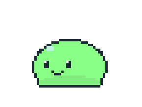

**Your own pixel-art desktop buddy for [Omarchy](https://omarchy.org).** It lives below your windows, wanders around,
naps, reacts when you poke it, and acts out what Claude Code and Codex are doing, so you can look away from the
terminal and still know when it's your turn.

Every buddy is a **sprite pack you draw yourself**, and a bar widget manages them.
There's a [step-by-step guide](docs/quick-setup.md). Draw in a pixel-art program such as Aseprite or the free
LibreSprite. (An experimental built-in pixel editor lives on the `experimental/pixel-editor` branch.)

   

<br clear="right">

**Contents:** [Install](#1-install) · [Connect your agents](#2-connect-claude-code-and-codex) · [Draw your own](#3-draw-your-own-buddy) · [Give it a voice](#4-give-it-a-voice) · [The bar widget](#the-bar-widget) · [Sprite packs](#sprite-packs) · [Walking](#walking) · [Roles](#roles-and-the-bundled-packs-tag-names) · [Config](#config) · [Commands](#commands) · [Uninstall](#uninstall)

## What you get

<table>
  <tr>
    <td align="center" width="170">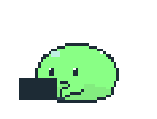</td>
    <td><b>A live status light for your agents.</b> Thinking, working, reviewing, waiting for you, done, error: each has its own animation and speech bubble. When the agent needs you, you also get a notification.</td>
  </tr>
  <tr>
    <td align="center" width="170">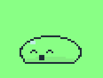</td>
    <td><b>A pet you can play with.</b> Click it and it hops. Grab it, throw it, and watch it bounce off the screen edges. Left alone, it walks, turns, naps and stretches.</td>
  </tr>
  <tr>
    <td align="center" width="170">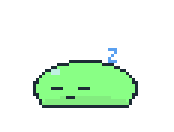</td>
    <td><b>Your art, live.</b> Draw in Aseprite (or another art program), hit save, and the buddy changes about a second later. Name animations however you like; the widget figures out what each one is for.</td>
  </tr>
  <tr>
    <td align="center" width="170">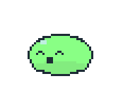</td>
    <td><b>Its own personality.</b> Per-pack lines for every state and animation, usage moods as your rate limits run down, murmurs and a chat window powered by your own <code>claude</code> or <code>codex</code> CLI.</td>
  </tr>
</table>

**Three buddies to start with:** Goop, made by me, and two others (Clawd and Mochi), made by Claude Code.
Each one has every animation and its own lines. Pick one in the bar widget, or draw your own.

<table>
  <tr>
    <td align="center"><br><b>Goop</b> the slime<br><code>default</code></td>
    <td align="center">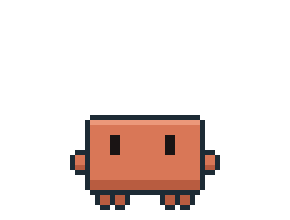<br><b>Clawd</b>, Claude Code's mascot<br><code>clawd</code></td>
    <td align="center">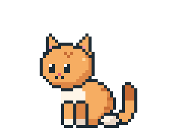<br><b>Mochi</b> the cat<br><code>mochi</code></td>
  </tr>
</table>

## 1. Install

```bash
omarchy plugin add https://github.com/NobiBot/omarchy-pixel-buddy --enable
```

It asks you to confirm and which bar section the widget goes in (right is a good spot). Then **click the
buddy icon in the bar**: a **Finish setup** card lists anything still missing, with a button for each:

- **Install Pillow**, if your system doesn't have it yet. The pack builder needs it; a terminal opens and
  asks for your password. A notification tells you when this is missing.
- **Connect Claude Code / Codex**, for the agents you have installed (see the next step).

Then **Goop** the slime, the default pack, appears on your desktop. **Clawd** (Claude Code's mascot) and **Mochi** the cat
come along too: pick one in the bar widget. Everything else it uses (`jq`, `socat`,
`notify-send`, `inotify-tools`, `qt6-imageformats`) comes with Omarchy.

<details>
<summary>Installing by hand instead</summary>

```bash
omarchy pkg add python-pillow
git clone https://github.com/NobiBot/omarchy-pixel-buddy ~/.config/omarchy/plugins/nobi.pixel-buddy
omarchy plugin enable nobi.pixel-buddy --section right
```

Or add `{ "id": "nobi.pixel-buddy" }` to `bar.layout.right` in `~/.config/omarchy/shell.json` yourself.
</details>

> [!NOTE]
> Aseprite is optional (see [Draw your own buddy](#3-draw-your-own-buddy)). If you change the plugin's QML
> files yourself, run `omarchy restart shell` to load them.

## 2. Connect Claude Code and Codex

Click **Connect** in the Finish setup card (or **Connect agents** on the widget's home screen if you
picked Not now). It backs up and edits `~/.claude/settings.json` and/or `~/.codex/hooks.json`, only for
the agents you have. From a terminal instead:

```bash
~/.config/omarchy/plugins/nobi.pixel-buddy/bin/pixel-buddy-install-hooks   # --claude-only, --codex-only, --uninstall
```

Start a new Claude Code or Codex session and the buddy follows along:

| 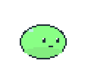 |  | 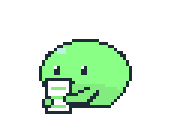 | 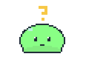 |  | 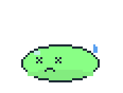 |
|:---:|:---:|:---:|:---:|:---:|:---:|
| thinking | working | reviewing | waiting for you | success | error |

The plugin uses its own names everywhere (`pixel-buddy-hook`, socket `$XDG_RUNTIME_DIR/pixel-buddy/`, config `~/.config/pixel-buddy/`,
state `~/.local/state/pixel-buddy/`, IPC `omarchy-shell pixel-buddy …`), so it can run next to the original Agent Pet.

## 3. Draw your own buddy

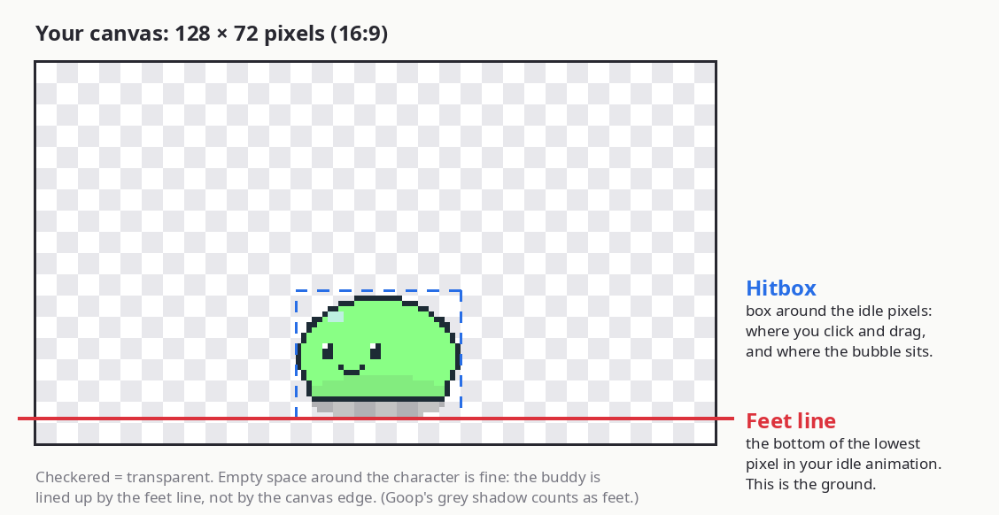

1. Left-click the buddy icon in the bar → **+ New** → type a name → **Enter**. Your buddy switches to the
   new, empty pack and its canvas opens in Aseprite.
2. Draw your character **facing left** near the bottom of the 128 × 72 canvas, on a transparent background.
3. Save (**Ctrl+S**). About a second later it's on your desktop.

That one `idle` animation is enough to start. The **[quick setup guide](docs/quick-setup.md)** covers the rest:
frames, tags, the feet line, and adding walks and reactions.

**No Aseprite?** Step 1 makes a blank 128 × 72 `idle.png` instead. Click **Folder** in the widget and open it
in any pixel-art editor, such as [LibreSprite](https://libresprite.github.io/) (free). See
[Other editors](docs/quick-setup.md#other-editors) for animations and sprite sheets.

## 4. Give it a voice

Open **Phrases** from the bar widget and write what this buddy says for each work state, like
“On it!” for working or “Your turn!” for waiting. Each line gets a **chance %**, so some lines are rare and some states
can stay quiet. You can give lines to any animation too: a sleepy “zzz…” when it naps.

---

# Reference

## Sprite packs

New to pixel art? Start with the **[quick setup guide](docs/quick-setup.md)**: it walks through drawing
your first buddy and how to place it on the canvas so it stands on the ground.

Every buddy design is a **pack**: a folder in `~/.local/share/pixel-buddy/packs/` holding the art plus an
optional `pack.json` (**Folder** in the widget opens it). The packs live outside the plugin folder because
Omarchy reloads every plugin when a file inside `~/.config/omarchy/plugins/` changes.

Goop, Clawd and Mochi (see [What you get](#what-you-get)) are the packs `default`, `clawd` and `mochi`. To start a
new buddy from one of them, right-click it in the widget → **Duplicate**.

<details>
<summary>Where the bundled buddies come from (for editing them)</summary>

Each lives in `templates/<id>/`: `buddy.aseprite`, `pack.json` (geometry and phrases) and `buddy.png` +
`buddy.json`, a PNG sheet of the same frames for installs without Aseprite. On start the plugin copies every
bundled buddy it hasn't copied before into `~/.local/share/pixel-buddy/packs/<id>/` (so an update that adds a
buddy brings it in, and one you deleted stays gone; `~/.local/share/pixel-buddy/bundled.json` keeps the list).
After editing a `templates/<id>/buddy.aseprite`, run `bin/pixel-buddy-pack template-png <id>` to re-export the PNG.
</details>

A pack can mix these formats:

| Files | Becomes |
|---|---|
| `*.aseprite` / `*.ase` | one animation per tag (a file without tags is one animation named after the file); a tag's Repeat is baked in |
| `name.png` + `name.json` | a sprite sheet: an Aseprite/LibreSprite JSON export, or `{"frameWidth":128,"frameHeight":72,"fps":10,"animations":{"idle":[0,3],"walk":{"from":4,"to":11}}}` |
| `name.png` alone | a horizontal strip of 16:9 (or square) frames |
| `name.gif` / `name.webp` | one ready-made animation called `name` |

Draw the buddy facing left, or set "drawn facing: Right" in the editor. Any canvas works: the
builder pads it to 16:9 and keeps the feet on the bottom edge.

## Walking

The buddy walks on its own: every time an animation ends it picks what to do next, by default idle 55%,
turn 15%, walk 15%, random action 15% (`animationWeights` in the config), split evenly between the
animations in each role. The Behavior tab gives each idle, walk, turn and random-action animation its
own **chance %**; ones left on auto share what the others leave, in the same proportions. A walk plays an animation
from the **walk** role (one walk cycle is enough; it loops for the whole trip) while the buddy slides
across the screen at the pack's walk speed (Behavior tab, canvas pixels per second). It walks the way
it faces. With a **turn** animation it turns around now and then; without one it picks a direction
for every walk and simply flips. To start a walk right away, right-click the buddy → **Actions** → **Move** → the walk.

The buddy is centered on its hitbox, so a character drawn off-center on the canvas still walks and
flips in place; set the hitbox around the body with the geometry editor's **Fit to sprite**.

## The bar widget

`omarchy plugin add … --enable` puts the widget on the bar. To move it later, run
`omarchy plugin enable nobi.pixel-buddy --section left` (or `center`, `right`).
The icon is your buddy's first idle frame. **Left-click** opens the popup and **right-click** hides or
shows the buddy.

- **Home:** previews the selected pack (‹ › steps through its roles), shows how many roles are
  mapped, and lists every pack. Click a pack to look at it and **Use for <buddy>** to switch to it
  (double-click does both). **Right-click** a pack for Use, Edit, Duplicate, Open folder and Delete
  (asks first, then moves the pack to `~/.local/share/pixel-buddy/trash/`). **+ New** creates a pack with a blank 128×72 Aseprite canvas (one frame tagged
  `idle`), puts it on the buddy and opens it in Aseprite. Without Aseprite it creates a blank 128×72 `idle.png`
  instead, for any pixel-art editor. **Aseprite**, **Rebuild** and **Folder** act on the selected pack; **Aseprite** explains
  how to use another editor when Aseprite isn't installed.
- **Edit pack → Roles:** the buddy asks for roles (idle, walk, the six work states, …), not tag names.
  The widget guesses each role from your animation names ("Stand" → idle, "run_cycle" → walk,
  "Think" → thinking). Dropdowns fix the rest. Roles with several animations pick one at random.
  A role with nothing mapped is skipped: the buddy just carries on (a work state still shows in the bubble). **Guess again** forgets your choices. Your source files
  are never renamed: the mapping is stored in `pack.json`.
- **Behavior:** how long each animation loops (in seconds, rounded up to whole plays; the line under each
  animation says how many times it plays, and 0 s plays it once), walk speed, and the chance % of each idle, walk, turn and
  random action being picked next (like a phrase's chance; ↺ puts one back on auto).
- **Geometry:** which way the art faces, the on-screen size, and **Open geometry editor**: drag
  the feet line and the hitbox (click/drag area; the speech bubble sits on its top edge) over a
  zoomed frame. The buddy follows live, and Save writes `pack.json`.
- **Phrases** (also a button on Home for the selected pack): what a buddy using this pack says in
  its speech bubble for each work state (thinking, working, reviewing, waiting for you, success,
  error), so each sprite can have its own voice. Edit a line and press Enter, add one in the
  "+ add a line" field, × removes it, ▶ shows it on the buddy. Each time the state changes a line
  is picked by its **chance %**; a state with no lines shows no bubble. Lines left on auto share
  whatever % the others leave, so by default every line is equally likely. If every line has its own %
  and they add up to less than 100, the rest of the time the buddy says nothing (the tab shows how often);
  ↺ puts a line back on auto. A pack without its own lines uses
  `workStatusTexts` from the config; the first edit copies those into the pack, and **Reset to defaults** goes back.
  Below the work states, **Animations** lists every animation in the pack by its tag name, custom names
  included. Give one some lines and each time that animation starts the buddy says one, picked by the
  same chance %. Give lines on idle or walk a low % (a work status, murmur or chat in the bubble takes priority).
- **Info:** name, author, files, build warnings, Duplicate, Delete (moves the pack to
  `~/.local/share/pixel-buddy/trash/`).

Saving a source file rebuilds its pack about a second later, and the buddy switches to the new
frames on its own. To rebuild by hand: `bin/pixel-buddy-pack build [pack] [--force]`. Builds go to
`~/.cache/pixel-buddy/` (safe to delete). Aseprite is found on PATH or in your Steam library, or set
`ASEPRITE=/path/to/aseprite`. The builder needs `python-pillow` and `inotify-tools`.

Each buddy's pack choice is stored in `~/.config/pixel-buddy/ui.json`. A buddy can also name one in
`config.jsonc` (`"buddies": [{ "id": "main", "pack": "mochi", … }]`), and the widget's choice wins.

`pack.json`, if you'd rather write it by hand:

```jsonc
{
  "name": "Mochi", "author": "you",
  "facing": "left", "scale": 3,              // on-screen width = canvas width × scale
  "feetY": 66, "hitBox": [46, 38, 82, 67],   // canvas pixels; left out = measured from the idle animation
  "minPlaySec": 5,
  "roles": {                                 // only the roles you set; the rest are guessed
    "idle": ["Stand"], "walk": ["run_cycle"], "clicks": ["Boing", "Blush"], "actions": ["Nap", "Dance"],
    "workStatus": ["Think", "Type", "Read", "Wait", "Yay", "Oops"],   // null = guess, "" = skip (no animation)
    "balance": [null, null, null, null, "Tired", "Empty"]
  },
  "behavior": { "playSec": { "Dance": 0 }, "speed": { "run_cycle": 30 }, "chance": { "Nap": 5 } },  // chance: % picked next, left out = auto
  "phrases": [                               // work-status bubble lines, same order as workStatus; left out = the config's
    ["Hmm…"], ["On it!"], ["Checking…"], ["Your turn!"], ["Done!"], ["Oops."]
  ],
  "animPhrases": {                           // said when that animation starts
    "Nap": ["zzz…", "five more minutes"],    // no chance = share what's left of 100%
    "Stand": [{ "text": "Nice day.", "chance": 5 }]   // 5% of the time; silent the other 95%
  }
}
```

## Roles and the bundled packs' tag names

| Role | Tag names |
|---|---|
| Idle loop | `idle` |
| Turn around (should end facing the other way) | `turn` |
| Held by the mouse | `drag` |
| Left-click reactions, picked at random | `click-hop`, `click-surprised` |
| Walking: a walk cycle that loops while the plugin slides the buddy at `speed` | `walk` |
| Random actions | `sleep`, `stretch`, `look-at-wallpaper` (plays once) |
| Work status, in this order: thinking, working, reviewing, waiting for you, success, error | `work-thinking`, `work-working`, `work-reviewing`, `work-waiting`, `work-success`, `work-error` |
| Usage level, 6 tiers from 0% to 100% used | `usage-plenty` ×2, `usage-ok` ×2, `usage-low`, `usage-empty` |
| Murmur bubble | `whisper` |

To add more, draw a new animation and add it to a role in the widget's Roles tab.

## Config

Defaults are in `assets/config.json`. Your overrides go in `~/.config/pixel-buddy/config.jsonc` (comments allowed), and they apply on save.
Each **top-level** key you write replaces the default key as a whole. So if you override `animations`, copy the full block.

`sprite` is the fallback geometry and timing for packs that don't set their own:

```jsonc
{
  "sprite": {
    "width": 128, "height": 72,     // canvas size, 16:9
    "feetY": 66,                    // pixel row the feet stand on
    "hitBox": [46, 38, 82, 67],     // x0, y0, x1, y1: the click/drag/bubble area
    "fps": 10,                      // your frame rate; used to time walks
    "minPlaySec": 5,                // short loops (idle, actions, walks, events) repeat until at least this long
    "playSec": { "walk": 3 }        // e.g. per-animation length in seconds (default {}); 0 = play once
  },
  "buddies": [{ "name": "Pixel", "id": "main", "size": 384, "position": { "corner": "bottom-right", "marginX": 24, "marginY": 0 } }]
}
```

- **Walk speed** is `animations.moves.default.speed`, in canvas pixels per second (default 24). You can override it per walk in `moves.actions[].params`. The walk cycle repeats for as many whole loops as the trip takes. Without a `speed`, the buddy uses the original behavior: one play of the animation, stretched by `minPlaySec`.
- **Timing:** the builder records each animation's real loop length, so held frames and per-frame durations are timed correctly.
- **`size`** is the on-screen width when the pack sets no `scale`. Keep it a whole multiple of the canvas width (384 = 128 × 3) so pixels stay square and even.
- **`whisperPrompt`** is the buddy's personality for murmurs and chat.
- **Stickers:** put PNGs in `~/.config/pixel-buddy/memes/` and list them under `memes` as `"file name without .png": "when to use it"`. Chat and murmur bubbles can then show them. (They live outside the plugin folder so plugin updates don't remove them.)
- **`physics`** (gravity, bounce, throw power) works like the original; see the [agent-pet configuration reference](https://github.com/chthollyphile/agent-pet#configuration).

The other options, with their defaults:

| Key | Default | What it does |
|---|---|---|
| `agents` | `{ "claude": true, "codex": true }` | Which agents' hook events the buddy follows |
| `notificationsEnabled` | `true` | Desktop notifications for waiting / done / error |
| `notify.onlyWhenUnfocused` | `true` | Skip the notification when the agent's terminal is the focused window |
| `workStatusTexts` | six lists of lines | Work-status bubble lines for packs without their own `phrases` |
| `workStatusDetail` | `false` | Add the current tool and its command or file under the bubble line |
| `stepSummary.mode` | `"off"` | `"transcript"` shows the agent's own latest words; `"model"` asks `autoModel` for a one-line summary every `stepSummary.intervalSec` (60) seconds |
| `llm` | `{ "provider": "claude", "claudeModel": "haiku", "codexModel": "" }` | The CLI and model for murmurs and chat |
| `autoModel` | `{ "provider": "claude", "claudeModel": "haiku", "codexModel": "gpt-5.6-luna" }` | The CLI and model for automatic tasks (step summaries, timed murmurs) |
| `whisperAuto` | `false` | Murmur on a timer (`eventsRefreshSec.whisper`, 300 s), skipped while an agent is busy |
| `chatMemoryRounds` | `5` | How many past chat rounds each request includes (the last 100 are kept in `~/.local/state/pixel-buddy/memory.json`) |
| `usage` | `{ "agent": "auto", "source": "auto", "refreshSec": 900 }` | Whose limits to show (`auto` = the last agent seen), where they come from (`omarchy`, `builtin` or `auto`) and how often to refresh them |
| `eventsRefreshSec.balance` | `1800` | How often the buddy shows its usage mood on its own |
| `clickAction` | `"react"` | `"usage"` makes a click show usage instead of a click reaction |
| `bubbleFont` | `{ "family": "", "file": "", "size": 14 }` | Bubble font: an installed family, or a font file path (`~` allowed) |
| `layer` | `"top"` | `"overlay"` keeps the buddy above fullscreen windows |
| `whisperImageEnabled`, `chatImageEnabled`, `chatImageLimit` | `true`, `true`, `10` | Whether murmurs and chat may show stickers, and how many sticker names chat offers the model |

## Commands

```bash
omarchy-shell pixel-buddy play work-success   # play an animation by name (handy for testing)
omarchy-shell pixel-buddy say "hello"
omarchy-shell pixel-buddy chat "how's it going?"   # ask the buddy something; it answers in its bubble
omarchy-shell pixel-buddy usage | whisper | toggle | reload | state
omarchy-shell pixel-buddy packs                 # list packs as JSON
omarchy-shell pixel-buddy usePack mochi         # all buddies; or main=mochi for one buddy
omarchy-shell pixel-buddy buildPack mochi | editGeometry mochi
omarchy-shell pixel-buddy-studio toggle | edit roles | edit phrases   # the bar popup (bind it to a key if you like)
```

## Uninstall

```bash
~/.config/omarchy/plugins/nobi.pixel-buddy/bin/pixel-buddy-install-hooks --uninstall   # remove the agent hooks first
omarchy plugin remove nobi.pixel-buddy
```

That leaves your packs and settings in place, in case you reinstall. To delete them too:

```bash
rm -rf ~/.local/share/pixel-buddy ~/.config/pixel-buddy ~/.cache/pixel-buddy ~/.local/state/pixel-buddy
```

## Credits

Credit goes to [agent-pet](https://github.com/chthollyphile/agent-pet) (MIT), which ported its behavior from
[dsh-pet](https://github.com/PC2005-cloud/dsh-pet) (MIT). See LICENSE.
