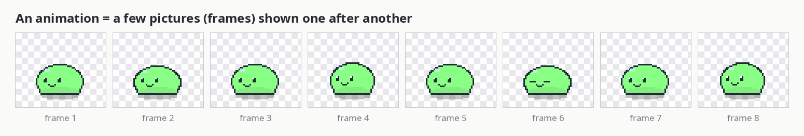
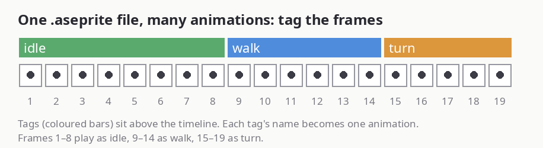
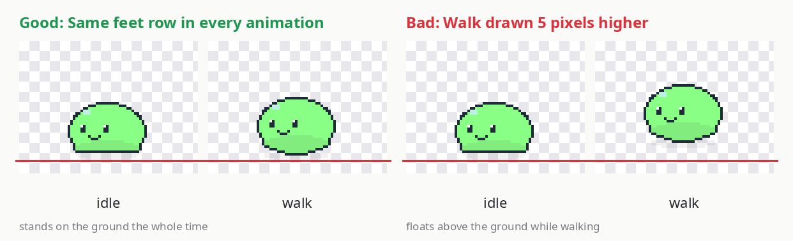

# Quick setup: draw your first buddy

New to pixel art or animation? This walks you from nothing to your own buddy on the desktop.
You only need one animation (idle) to start. Add more whenever you like.

## A few words first

| Word | Meaning |
|---|---|
| **Pixel art** | Pictures drawn one square (pixel) at a time, on a tiny image. The buddy is drawn small and scaled up. |
| **Canvas** | The image you draw on. For the buddy it's **128 × 72 pixels**. |
| **Frame** | One picture of an animation. |
| **Animation** | A few frames shown one after another, like a flipbook. Goop's idle is 8 frames at 0.1 s each. |
| **Tag** | A name you put on a run of frames in Aseprite. Each tag becomes one animation. |
| **Transparent** | Empty pixels. Leave everything that isn't your character empty (shown as a checkerboard). |

## What you need

An art program for pixel art. The steps below use **[Aseprite](https://www.aseprite.org/)**, the most capable option.
It costs money (also on Steam), or you can install it free with `yay -S aseprite`, which builds it from its source code
and takes a while. For a free alternative, [LibreSprite](https://libresprite.github.io/) (`sudo pacman -S libresprite`)
works too: see [Other editors](#other-editors).

## Step 1: make a pack

Left-click the buddy icon in the bar → **+ New** → type a name.
This makes a pack with a blank 128 × 72 canvas, switches your buddy to it and opens it in Aseprite.
(Without Aseprite you get a blank 128 × 72 `idle.png` instead: see [Without Aseprite](#without-aseprite).)
(The buddy will be invisible until you draw something.)

## Step 2: draw the idle pose

1. Draw your character **facing left**, standing near the bottom of the canvas. Goop is about 30 pixels wide and 25 tall. Small is fine: it gets scaled up.
2. Keep the background **transparent**. Don't fill it with a color.
3. Save (**Ctrl+S**). About a second later the buddy appears on your desktop.

The plugin works out two things from your idle animation:

- **The feet line**: the bottom of your lowest pixel. That row stands on the ground (the bottom of your screen, or whatever the buddy lands on).
- **The hitbox**: the box around your pixels. That's where you click and drag, and the speech bubble sits on top of it.

Anything you draw counts, so a shadow under the feet (like Goop's) or one stray pixel far away changes both. Zoom out and check for stray pixels if the buddy stands too high or the bubble is in the wrong place.

## Step 3: make it move

1. Press **Alt+N** to add a frame. It starts as a copy of the current one; change it a little (squash, blink, bob up a pixel).
2. Repeat for 2–8 frames. Turn on **onion skin** (**F3**) to see the previous frame faintly while you draw, so the character stays in place.
3. The new frames have to be inside the `idle` tag. Select all the idle frames in the timeline, right-click the frame numbers → **New Tag** (or stretch the existing tag) and name it `idle`.
4. Save. The buddy now plays your loop.

To make a frame last longer, double-click it in the timeline and raise its duration (100 ms = 0.1 s).

## Step 4: add more animations

Draw more frames after idle in the **same file** and give each run of frames its own tag.
Good next ones, in order of how often you'll see them:

| Tag | When it plays | Tip |
|---|---|---|
| `walk` | Walking across the screen | One step cycle is enough; it loops while the buddy slides. Draw it walking in place, not moving across the canvas. |
| `drag` | Held by the mouse | Dangling or surprised. |
| `click-hop` | You click it | A short hop or wiggle. |
| `turn` | Turning around | Must end facing **right**. Optional: without it the buddy just flips. |
| `sleep`, `stretch` | Random actions | Any idle-time fun. |
| `work-thinking`, `work-working`, … | Claude Code / Codex status | See the role list in the [README](../README.md#roles-and-the-default-packs-tag-names). |

You don't have to use these names. Call your tags whatever you like, then open the bar popup → **Edit pack → Roles** and pick which animation plays for what.
Anything you leave out is simply skipped.

## The rules that keep it lined up

The feet line and hitbox come from idle and are used for **every** animation. So in every frame of every animation:

1. **Feet on the same row** as in idle. Higher and the buddy floats; lower and it sinks into the ground. (A jump is fine: the feet leave the row for a moment and come back.)
2. **Same spot left to right.** The character can be off-center, but always the same off-center, or it jumps sideways when the animation changes.
3. **Facing left**, all of them. (If you drew everything facing right, set *drawn facing: Right* in **Edit pack → Geometry** instead.)
4. **One canvas size** for the whole pack. Keep everything in one Aseprite file and this takes care of itself.

Onion skin (F3) is the easiest way to check 1 and 2: the previous frame shows through, so you can line the feet up with it.

## Size on screen

**Edit pack → Geometry → scale** sets how big the buddy is: on-screen width = 128 × scale (Goop uses 2, so 256 pixels wide).
Use a whole number so every pixel stays a crisp square.

## If it doesn't sit right

Open **Edit pack → Geometry → Open geometry editor**. Pick the idle animation and click **Fit to sprite**, or drag the green feet line and the hitbox box (drawn in your theme's accent color) yourself.
The buddy follows live; **Save** keeps it.

| Problem | Fix |
|---|---|
| Floats or sinks in one animation | That animation's feet are on a different row. Move its pixels up or down to match idle. |
| Floats or sinks all the time | A shadow or stray pixel is below the feet. Delete it, or drag the feet line up in the geometry editor. |
| Jumps sideways when the animation changes | That animation is drawn further left or right. Line it up with idle using onion skin. |
| Walks backwards | Some frames face right. Flip them (**Edit → Flip Horizontal**), or set *drawn facing*. |
| Blurry or uneven pixels | Use a whole-number scale. |
| Nothing changes after saving | Check **Edit pack → Info** for build errors. If Aseprite isn't found, set `ASEPRITE=/path/to/aseprite`. |

## Without Aseprite

### Other editors

Any editor that exports a **GIF** or a **PNG strip** works, for example [LibreSprite](https://libresprite.github.io/) (`sudo pacman -S libresprite`) or [Piskel](https://www.piskelapp.com/) in the browser.
Set the canvas to **128 × 72**, click **Folder** in the bar popup, and export into the pack's folder. The **file name becomes the animation name**:

- `idle.gif` → an animation called `idle`. Easiest: most editors export GIF.
  (A pack made with **+ New** without Aseprite starts with a blank one-frame `idle.png`: open it, draw, and add frames to the right.)
- `walk.png` as a **strip**: all frames side by side in one row, each frame 128 × 72 (so 6 frames = a 768 × 72 image). Each frame plays for 0.1 s.

The same rules apply: same canvas size, feet on the same row, facing left.
Every export is picked up about a second later; **Rebuild** in the popup forces it.
